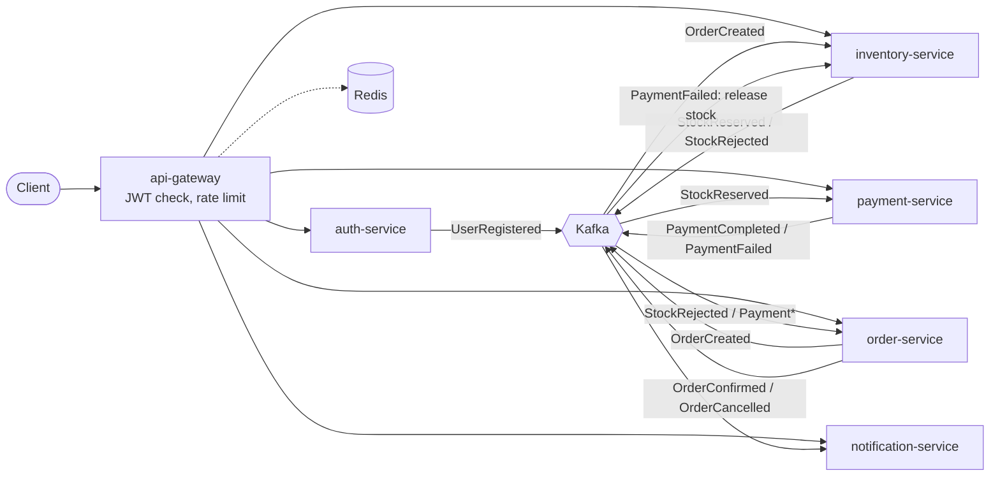

# Order & Payment Platform

An event-driven microservices reference project in **Java 21 / Spring Boot 3**. A customer registers, logs in and
places an order; stock reservation, payment and notification happen asynchronously across independent services that
stay consistent through a **choreography-based saga** with compensation.

It is built to show the problems that matter in real distributed systems, not just CRUD behind a gateway:
no distributed transactions, at-least-once delivery, duplicate messages, partial failure and observability.

## Architecture



Every service owns its own PostgreSQL database. Services only talk to each other through Kafka events; the gateway
is the single synchronous entry point. More detail and the saga sequence: [docs/architecture.md](docs/architecture.md).

| Service | Host port (container port is 8080-8085) | Responsibility |
|---|---|---|
| `api-gateway` | 18080 | Routing, JWT validation at the edge, Redis rate limiting |
| `auth-service` | 18081 | Registration, login, JWT issuing (BCrypt), `UserRegistered` event |
| `order-service` | 18082 | Order lifecycle, starts and finishes the saga, idempotent order creation |
| `inventory-service` | 18083 | Catalogue, stock reservation with row locks, compensation |
| `payment-service` | 18084 | Charges the customer, circuit breaker + retry around the (simulated) provider |
| `notification-service` | 18085 | Reacts to events, keeps a local copy of contact data |
| `platform-common` | - | Event contracts, transactional outbox, idempotent-consumer guard, Kafka/security defaults |

## Patterns and where to find them

| Pattern | Where |
|---|---|
| Saga (choreography) with compensation | `OrderService`, `InventoryService`, `PaymentService` handlers |
| Transactional outbox | [`platform-common/.../outbox`](platform-common/src/main/java/com/hasancetin/platform/common/outbox) |
| Idempotent consumer | [`IdempotencyGuard`](platform-common/src/main/java/com/hasancetin/platform/common/idempotency/IdempotencyGuard.java) |
| Idempotent API (`Idempotency-Key`) | `OrderService.createOrder` + unique index in `V1__create_orders.sql` |
| Retry + dead-letter topics | `PlatformAutoConfiguration.kafkaErrorHandler` |
| Circuit breaker, retry, fallback | `PaymentGateway` (Resilience4j) |
| Oversell protection | `ProductRepository.lockBySkuIn` (pessimistic lock, sorted to avoid deadlocks) |
| Event-carried state transfer | `notification-service` keeps `user_contact` from `UserRegistered` |
| Database per service + Flyway | `src/main/resources/db/migration` in each service |
| Stateless JWT security (edge + service) | `GatewayConfig`, `PlatformSecurityAutoConfiguration` |
| Metrics, tracing, correlated logs | Micrometer + Prometheus, OpenTelemetry to Jaeger, `traceId` in log lines |

Design decisions are written down as ADRs in [docs/adr](docs/adr).

## Run it

Requirements: Docker, and for local builds JDK 21+ and Maven.

```bash
docker compose --profile apps up -d --build
```

Then run the end-to-end scenario (needs `curl` and `jq`):

```bash
./scripts/demo.sh
```

It registers a user and shows: a confirmed order, an order cancelled because stock ran out, an order cancelled
because the payment was declined (with the reserved stock released again), idempotent order creation,
notifications and the 401 without a token.

| Tool | URL |
|---|---|
| API (gateway) | http://localhost:18080 |
| Swagger UI (all services, with JWT Authorize) | http://localhost:18080 (redirects to /swagger-ui.html) |
| Jaeger (traces) | http://localhost:16686 |
| Prometheus | http://localhost:9090 |
| Grafana | http://localhost:13000 |

Develop from the IDE: start only the infrastructure (`docker compose up -d`) and run the services directly,
the default configuration already points to the published `localhost` ports (Postgres 15432, Redis 16379, Kafka 29092).
Host ports are deliberately uncommon so the stack does not collide with a local Postgres/Redis/dev server.

### Try failures yourself

- **Payment provider outage:** set `PAYMENT_FAILURE_RATE=0.7` for `payment-service`; retries kick in, then the circuit
  breaker opens (`/actuator/circuitbreakers`, needs a bearer token) and orders are cancelled gracefully instead of hanging.
- **Poison message:** publish invalid JSON with an `event-type` header to a topic; it lands on `<topic>.DLT` after the
  retries instead of blocking the consumer.
- **Duplicate delivery:** replay an event from Kafka; the `processed_event` table makes the second delivery a no-op.

## Build and test

```bash
mvn verify
```

Unit tests cover the saga handlers (happy path, compensation, duplicates, late messages), token issuing and the event
serialization contract.

## What is deliberately simplified

- Item prices come from the order request; a real system would have a pricing/catalogue lookup.
- JWTs are signed with a shared HS256 secret (`JWT_SECRET`). Production would use asymmetric keys or an
  identity provider such as Keycloak, see [ADR 0004](docs/adr/0004-jwt-hs256.md).
- Payment provider is simulated (`SimulatedPaymentProvider`), the notification channel only logs.
- No service registry: Docker/Kubernetes DNS and environment variables are enough here ([ADR 0005](docs/adr/0005-no-service-discovery.md)).
- Outbox rows are not purged yet; a housekeeping job would delete old `SENT` rows.

## Roadmap

Kubernetes manifests / Helm chart, Testcontainers-based integration tests per service, schema registry (Avro or
Protobuf) for the event contracts, Grafana dashboards, outbox housekeeping.
