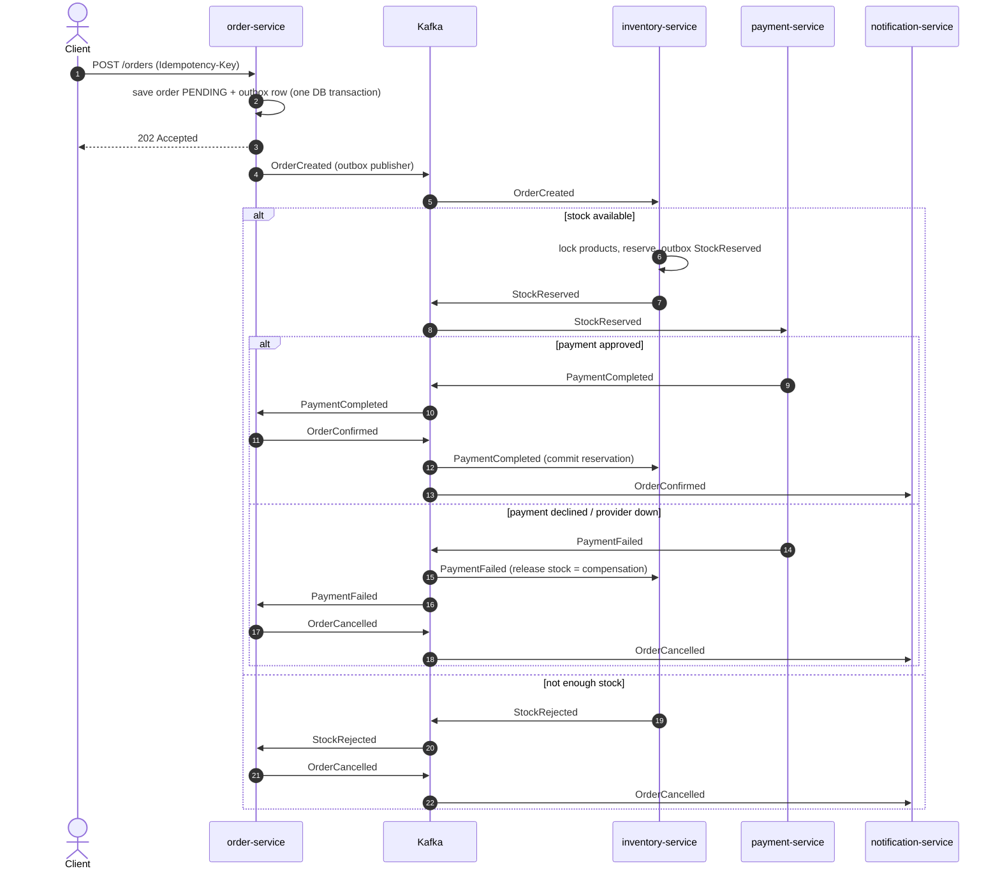

# Architecture

## Saga: place an order

## Reliability building blocks

**Transactional outbox.** A service never writes to the database *and* to Kafka in two separate steps (that can lose
or invent events). It writes the business change and an `outbox_event` row in one local transaction. A polling
publisher (`OutboxPublisher`, `SELECT ... FOR UPDATE SKIP LOCKED`) relays pending rows to Kafka and marks them sent.

**At-least-once + idempotent consumers.** If the publisher crashes after Kafka acknowledged but before the row is
marked sent, the event is delivered twice. Every handler therefore starts with
`IdempotencyGuard.markProcessed(eventId)`, an `INSERT ... ON CONFLICT DO NOTHING` into `processed_event` in the *same*
transaction as the business change. Rolled back means not marked, so the redelivery is processed; committed means all
duplicates are skipped.

**State guards.** Order transitions only apply while the order is `PENDING`, so late or out-of-order messages cannot
flip a confirmed order. Payments are unique per order id as a second line of defence against double charging.

**Failure handling.** A failing record is retried with exponential back-off (500 ms, 1 s, 2 s) and then published to
`<topic>.DLT`. Deserialization errors skip the retries. The payment provider call is wrapped by Resilience4j
(retry, then circuit breaker; an unavailable provider becomes a controlled `PaymentFailed`).

**Ordering.** The Kafka key is the order id, so all events of one order are processed in order per consumer.

## Security

The gateway validates the JWT and rate limits per client address. Each service is also an OAuth2 resource server and
validates the token again (defence in depth). The caller identity is the token subject (user id); orders, payments
and notifications are always filtered by it, and other users' resources answer `404`.

## Observability

- Metrics: Micrometer to `/actuator/prometheus`, scraped by Prometheus, Grafana is pre-wired to it.
- Tracing: OpenTelemetry (OTLP) to Jaeger. Kafka producers and listeners have observation enabled, so a trace follows
  an order from the HTTP request through every Kafka hop.
- Logs: every line carries `[service, traceId, spanId]`.
